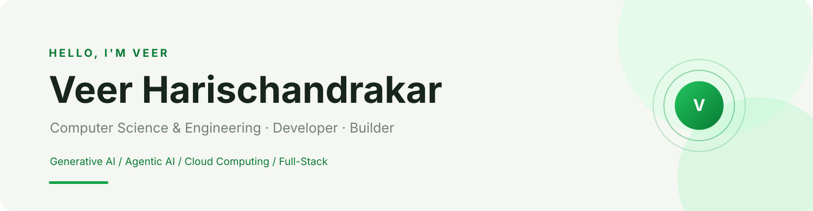
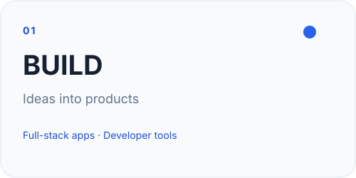
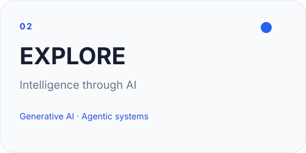
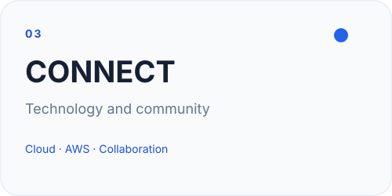
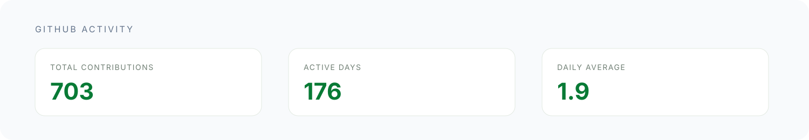
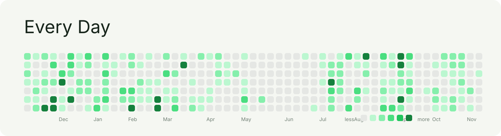
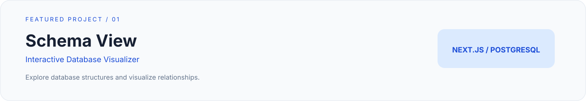
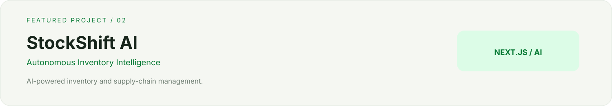
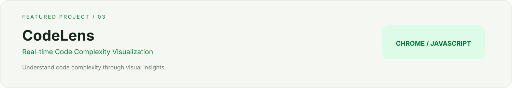
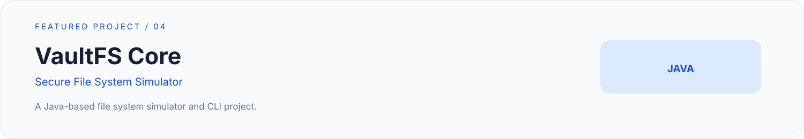

<!--
  VEER HARISCHANDRAKAR · GITHUB PROFILE
  Animated SVG profile cards
  SVG assets are generated by scripts/render_readme_cards.py
-->

 

  

COMPUTER SCIENCE & ENGINEERING · DES PUNE UNIVERSITY · PUNE, INDIA

---

## About Me

I'm a third-year Computer Science & Engineering student passionate about building intelligent applications, scalable cloud solutions, and useful developer tools.

Currently, I'm a **Google Student Ambassador** and **Technical Lead at AWS Student Builders**.

My interests lie at the intersection of **Generative AI, Agentic AI, Cloud Computing, and Full-Stack Development**.

I enjoy turning ideas into working products, experimenting with emerging technologies, and building solutions that solve real-world problems.

---

## Three Worlds I Build In

---

## GitHub Activity

 

---

## Featured Projects

---

## Technology Stack

**Languages**

  

**Frameworks & Libraries**

  

**Cloud & Databases**

  

**Tools**

---

## Developer Focus

| Area | What I'm Exploring |
|:---|:---|
| **Generative AI** | LLM integration, Gemini and AI-powered applications |
| **Agentic AI** | AI agents, tool calling and autonomous workflows |
| **Cloud Computing** | AWS, cloud architecture and scalable infrastructure |
| **Full-Stack Development** | React, Next.js, Node.js and modern databases |
| **Developer Tools** | Building tools that improve developer productivity |
| **Community** | Technical workshops, student communities and knowledge sharing |

---

## Certifications

- Prompt Design in Vertex AI
- Introduction to Large Language Models
- Generative AI Explained
- Introduction to Machine Learning: Art of the Possible
- AWS SimuLearn: File Systems in the Cloud

---

## Let's Connect

&nbsp;

&nbsp;

&nbsp;

  

**Always open to collaborating on AI, cloud, and full-stack projects.**

Designed with curiosity · Built with code · Powered by coffee

